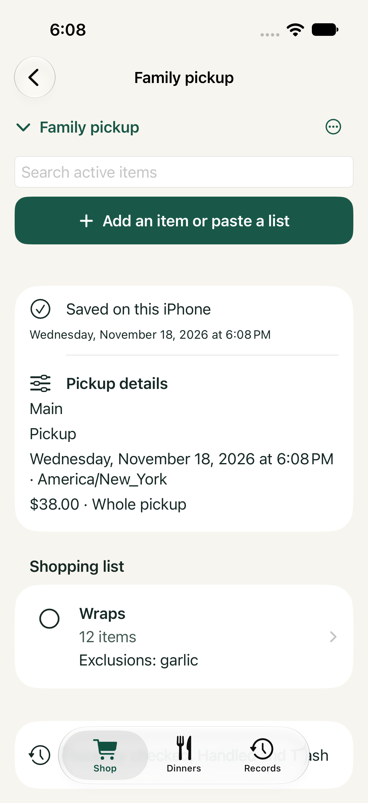
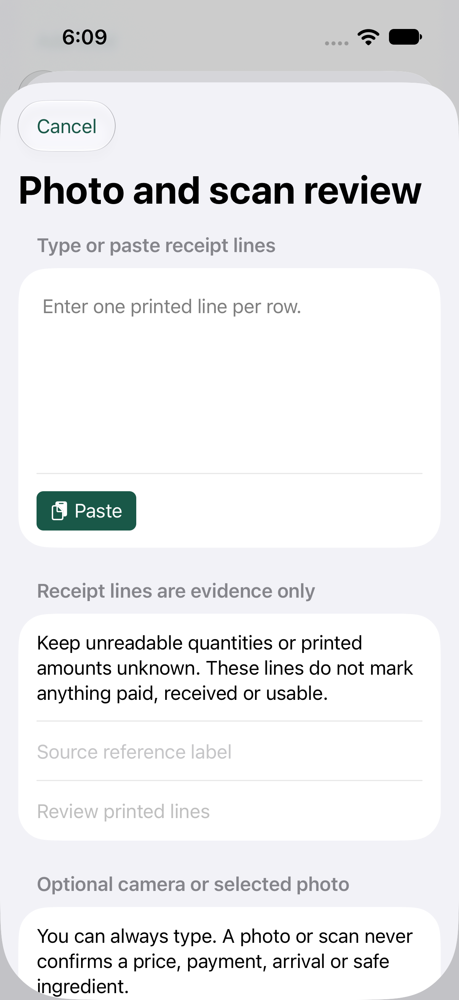

# Room in the Cart before branding

November 18, 2026 · US iPhone release candidate work

## Navigation decision

Keep **Shop**, **Dinners** and **Records** as the adult destinations for the first usability round. Shop answers “what am I buying or putting away?”, Dinners answers “what can we eat?”, and Records answers “what did I save earlier?”. The shipping target is iPhone. Keep the same names, order and destinations if the system presents navigation along an edge of a wider layout. A separate sidebar would duplicate those choices. In a compact layout keep the labeled bottom tabs. Give each tab its own return path. Open Settings from the gear. Launch the camera from a task that explains what its result will do. This also respects the limited access of invited contributors and cooks. [Screen contracts](product/foundation-gen2.1/03-screens.md) · [Apple on tab bars](https://developer.apple.com/design/human-interface-guidelines/tab-bars) · [Apple on sidebars](https://developer.apple.com/design/human-interface-guidelines/sidebars)

Fresh Shop already offers **Add a list**, **Compare packs**, and **Start pickup**. Compare packs currently gets the strongest visual emphasis. The ASO research leads with a short grocery list. Test which entry shoppers choose for a three-item list and which they choose when comparing packages. A Pantry tab is a credible alternative to test if users repeatedly look for their fridge outside Shop. First keep the name, tab count and competing actions constant across participants within each version.

### Observed iPhone walkthrough

Three walkthroughs passed on the ordinary Debug app using an iPhone 17 simulator, iOS 27.0, US English, default text size and a fictional active pickup. The following steps include branching paths from Shop. The counts use taps to open task entry.

1. **Shop.** The current pickup, Shopping list, My Pantry and checkout were visible without scrolling. The first two destinations had 44-point targets. [Shop screenshot](evidence/native/pre-branding-navigation-20261118/01-active-shop.png)
2. **Groceries.** One tap opened the existing list. The primary add control was visible above the saved status and pickup details. The first grocery appeared below those details. The original “Type or paste a list” label left single-item entry implicit. [Original list screenshot](evidence/native/pre-branding-navigation-20261118/02-groceries.png)
3. **Pantry and receipt.** From Shop, the first visit went through My Pantry, Confirm pantry setup, Review a receipt and Scan or type receipt lines. Each control was reachable without scrolling. At the input screen, the paste button was visible but the typing field began at y=887 in an 874-point viewport. Camera access was off. [Original receipt screenshot](evidence/native/pre-branding-navigation-20261118/03-receipt-input.png)
4. **Dinners.** From Shop, Dinners and then This week opened the meal calendar in two taps without scrolling. The week row had a 52-point target. The add-dinner action sits lower on the landing screen. Observe whether someone who knows they want to add dinner goes to the week first. [Dinners screenshot](evidence/native/pre-branding-navigation-20261118/04-dinners.png)

A second walkthrough verified the two changes prompted by these screens. The 370 × 52-point grocery button now says **Add an item or paste a list**. The English and Spanish buttons both opened the editor, and a shopper could type one item. In receipt entry the 338 × 150-point text field moved from y=887 to y=249 and became fully visible. Tapping it opened the keyboard and accepted “Oats 3 count” without scrolling or requesting camera access. The three follow-up UI walkthroughs passed.

| Adding one grocery after the change | Typing a receipt after the change |
| --- | --- |
|  |  |

These captures show default-size accessibility element frames. VoiceOver speech order, Switch Control operation, and usability with a real shopper require separate observation.

### Current paths from Shop

These counts trace named controls from the unlocked private Shop root. They exclude scrolling, typing, operating-system prompts and the final confirmation. A compact or wide system presentation can move the same control.

| Task | Path and taps |
| --- | --- |
| Start a list | **Add a list** opens the editor in one tap. Review and save follow. |
| Add one item to an existing list | **Shopping list → Add an item or paste a list** opens the editor in two taps. The label now names the single-item use as well as bulk entry. |
| Capture from a receipt | **My Pantry → Review a receipt → Scan or type receipt lines** reaches capture in three taps. The file route takes four to reach the picker. First-time pantry setup adds a step. |
| Put food in the fridge manually | **My Pantry → Add food** opens the editor in two taps. Choose Fridge, review and confirm. For receipt items without reliable storage evidence, the initial choice is Cupboard. The shopper can change it before saving. |
| Plan dinner | With a pickup available, **Dinners → Add a manual dinner** opens the editor in two taps. Review and apply follow. |
| Resume putting an order away | **Record what came home** opens the partially received pickup in one tap after the fix. Previously a partially received multi-line order required the pickup list and another selection. |
| Look up a newly saved food | A single private receipt batch now links to its guide from the save confirmation. Several batches share one expandable chooser. The saved food and location carry over. |

### Decisions to validate

| Settle before styling | Product decision to exercise |
| --- | --- |
| First use | An individual can start a list or compare packages offline. Ask for account access when they choose a household feature. Keep the signed-in household, the private kitchen and child requests visibly distinct. |
| Adding and editing | Use the action and destination in the label when either is ambiguous. Keep one obvious way back from a review. Test both a single forgotten item and pasting several at once. |
| Receiving groceries | The printed charge, the amount that arrived, its storage and the amount reserved for lunch are different facts. Reopening a partially recorded pickup should lead back to the outstanding items. |
| Camera and dates | Let people choose camera, an existing image or manual entry where supported. Review uncertain text and confirm the actual storage before saving stock. A FoodKeeper estimate needs a matched food, storage conditions and a relevant start date. A receipt date alone cannot establish a package expiration. [USDA FoodKeeper](https://www.foodsafety.gov/keep-food-safe/foodkeeper-app) |
| Trust and recovery | The screen should say whether an action is a local draft, an accepted save or waiting for a reply. Recover a confirmed receipt after interruption. Preserve the draft when a person can still read but can no longer post. Confirm sensitive actions and distinguish opening a support case from completing deletion. |
| Pricing and promises | Keep private shopping useful on its own. Explain the annual planning benefits at the paid feature. Test purchase, restore, expiration and management against the final StoreKit product. Every listing claim must be demonstrable with the submitted build and configuration. |
| Accessibility and language | Whoever completes a task using VoiceOver, large text or Spanish should reach the same outcome. Recheck focus after review, text entry with the keyboard visible, cancellation, offline messages and return from the camera. |

### What reads the receipt

With on-device photo processing enabled, Apple Vision reads the English or Spanish print on the receipt. App rules preserve the original line and extract possible names, quantities, units, prices and dates. The shopper can type, paste, edit or skip a line. A store abbreviation can be associated with a reviewed product spelling. An eligible enrolled adult can also redact one line and explicitly request an OpenAI suggestion when the operator enables and configures the feature. The normal local route works by itself. Evaluate the optional interpretation on paired, labeled English and Spanish receipts before enabling it. Measure corrections, unsupported suggestions, completion time and actual cost. Current fixture tests establish behavior but do not measure live provider accuracy. [Apple Vision](https://developer.apple.com/documentation/vision/vnrecognizetextrequest) · [Receipt assistance contract](../service/API-RECEIPT-ASSISTANCE.md)

The purchase review asks what actually came home, what is usable and where it was stored. Reliable printed wording or matching pantry history can suggest storage. A shopper can change it. The private food's guide searches a bundled FoodKeeper reference using the reviewed name and supplies its storage context. The shopper confirms the food, condition and relevant start date before saving a quality range. A price correction in Receipt history, a recount of a pantry batch and a revision to the saved quality guidance have different effects. A correction to one does not silently change the others. [USDA FoodKeeper](https://www.foodsafety.gov/keep-food-safe/foodkeeper-app)

### Recording a use when the amount is unknown

Open a private pantry batch and choose **Used some**, or open **Talk or type about pantry food** from My Pantry. A shopper can report using two eggs, pick which bread they used, and log an unmeasured use of flour in the same review. “I used about half the bottle” asks what remains. “Less than half left” saves a qualitative estimate. A shopper can leave an unresolved item unchanged before confirming the others.

Each confirmed use belongs to a batch. Usage history shows the total recorded uses, uses in the past 30 local calendar days, the most recent date and the earlier entries. A remaining-stock check by itself adds no use to that history. If the remaining amount is unknown, planning requires a new count before relying on a specific available quantity. In cooking, a shopper who changes to a substitute can keep their choice of **Used some**.

The workflow matches the shopper’s saved food names, including homemade foods and leftovers. Multiple batches with a matching name require a choice. A batch’s **Used some** button also works without entering a name. A shopper can describe the rice as “still kind of full,” the salsa as “more than half a jar,” or homemade soup as “enough for one more dinner.” The review keeps their wording. It asks which food an unnamed estimate describes and asks what “half” means outside a remaining-amount question. A full or nearly full food does not prompt a restock.

After recording low stock, the shopper can review adding the food to a shopping list or set a private check date. Notification settings are a separate choice. Estimated stock does not place an order. The microphone starts only after a tap, and the shopper reviews dictated words before applying changes. [Pantry interaction changes](https://github.com/palatis3/room-in-the-cart/pull/73) · [Private restock handoff](../ios/Features/Pantry/PantryRestockActions.swift) · [Private usage and recovery](../ios/Features/Pantry/PantryConsumption.swift)

The English simulator walkthrough distinguished two matching breads and saved a mixed-ingredient update. The Spanish walkthrough retained a custom broth’s “más de la mitad” estimate through relaunch and offered no low-stock action. The permission walkthrough denied the real iOS speech prompt and continued with the original typed words. [Choosing the bread](evidence/native/pantry-voice-20261118/01-choose-bread.png) · [Custom broth estimate](evidence/native/pantry-voice-20261118/08-estimacion-caldo.png) · [Private use history](evidence/native/pantry-voice-20261118/06-private-use-history.png) · [Typing after permission denial](evidence/native/pantry-voice-20261118/07-dictation-fallback.png)

## How to decide what is easier

Use fictional groceries in a local workspace. Begin on the real first screen or the named saved state. Give only the prompt, record the first tap and let the person finish unassisted. Note wrong turns, backtracking, lost input, what they expect Save to do, whether they can resume, and the actual saved result. Record the task-entry tap count separately from typing, camera interaction and meaningful consent. Ask where they expected to find the feature before showing another route.

| Prompt | Starting state | Observable success |
| --- | --- | --- |
| “You just remembered milk, eggs and coffee. Put them somewhere for your next grocery trip.” | Fresh private app | All three groceries reopen on the same list. The shopper can identify how to add another item. |
| “These two packages cost different amounts. Which would cover dinner and two lunches?” | Fresh Shop with two fictional labels | The shopper reaches comparison without creating a pickup. They can explain the usable amount and total. |
| “The receipt says eight wraps. Six came home usable. You're saving two for lunch. Put them away.” | Placed pickup with a receipt and confirmed physical quantities available | Four wraps are available to dinner, the printed charge is preserved, and rescanning does not create another batch. |
| “You just put this food in the fridge. Where would you check when to use it?” | Saved private receipt, known storage history | Shopper finds the correct saved food and can distinguish estimated quality dates from a date printed on its package. |
| “You used ketchup twice this week. You have no idea how much. Show me when you last used it.” | Saved private ketchup batch | The shopper records two uses, can find the most recent one, and can leave the remaining amount unknown. No grocery appears until they choose to add one. |
| “Move tacos to Friday, keep tomorrow’s lunch, and show what else you need to buy.” | Saved meal and an active pickup | The same planned meal moves, its lunch reservation survives, and the shopper finds the remaining demand. |
| “You lost your connection just after sending a household request. Find out whether it went through.” | Test household with a simulated interrupted reply | The person can recover the single accepted request without sending it twice. They can distinguish their request from another member’s. |

Run one round with people who buy groceries, including a frequent list-maker, someone who plans for a household and someone new to receipt scanning. Include US Spanish and people who rely on assistive technology. Compare concrete first choices and outcomes before changing the tab structure. Repeatedly looking for the fridge in Dinners or Records is evidence for testing a Pantry destination. A person who finds Shop immediately but gets stuck choosing between its actions points to an entry-screen problem. Recheck both the original task and its neighboring task after any change.

AnyList exposes direct item entry and keeps extra details optional. Paprika 4 lets people select purchased groceries and move them to a chosen pantry location. Mealime connects planned meals to a grocery list and lets people inspect the meals that use an ingredient. These are documented patterns. An observed session with Room in the Cart is still needed to choose between competing labels or tab structures. [AnyList adding items](https://help.anylist.com/articles/feature-overview-adding-items/) · [Paprika groceries](https://paprikaapp.com/help/v4/ios/groceries/) · [Mealime getting started](https://support.mealime.com/article/151-getting-started-guide)

## Follow-up integration review

| Where workflows meet | What changed |
| --- | --- |
| Cooking → pantry deduction | Choosing a new batch formerly kept the number while changing its unit. Using 2 g from a 4 kg batch now leaves 3.998 kg. The editor preserves the entered measurement or asks for a new one when the target batch lacks a compatible conversion. Both manually chosen batches and suggested substitutions use the same review. [Cooking fix](https://github.com/palatis3/room-in-the-cart/pull/69) |
| Files → shopping list | A plain-text grocery file shared from Files can open private shopping-list review. The shopper can edit or cancel. PDF and image receipts keep their receipt route. The receiving workspace and pickup are checked before committing. [Share extension fix](https://github.com/palatis3/room-in-the-cart/pull/70) |
| Placed order → arrivals | The remaining unobserved item is preselected when only one current retailer line qualifies. Received and usable amounts stay blank. The app supplies stable delivery references and distinguishes an explicitly new shipment from a retry, including when the original receipt used older custom references. [Delivery and storage changes](https://github.com/palatis3/room-in-the-cart/pull/71) |
| Pantry batch → USDA guidance | The same private batch now reopens its previously confirmed FoodKeeper product when its revision, storage and reference edition still match. A different product, changed batch or incompatible history calls for a fresh review. The shopper can choose a different match. [Delivery and storage changes](https://github.com/palatis3/room-in-the-cart/pull/71) |

Two further native review findings came from hosted tests. After a shared-order save reply was lost, scrolling could hide the recovery action on relaunch. Its original operation can now be retried from the bottom of the sheet. Separate tests on three screens reported a background-thread publication warning within a second of UTC midnight. A native SwiftUI reproduction emitted the same warning when a day-change notification arrived from a worker. Delivering the clock notifications on the main queue removed the warning in the reproduction and passed the mounted iOS regression. [Shared-order recovery](https://github.com/palatis3/room-in-the-cart/pull/75) · [Calendar-day updates](https://github.com/palatis3/room-in-the-cart/pull/74)

### Recovery and editing before branding

| Workflow | Regression covered |
| --- | --- |
| Sign in and choose a household | If the verification code succeeds but loading households fails, Settings offers a retry using the signed-in account. Creating a household becomes available once the app has loaded the current choices. |
| Keep using paid planning | An active named seat requests fresh verification before the five-minute deadline. An interrupted verification offers an in-app retry, and expired verification cannot authorize paid work. |
| Edit a long shopping list | Reopening shared grocery text keeps edited names, amounts and valid duplicate choices. Appending a pantry item or Shortcut to a saved first-list draft retains the rows already reviewed. |
| Adjust dinner after shopping | Removing one shopping contribution leaves the remaining ingredients available for cooking. Moving a dinner to another day preserves its own unchanged ingredient reservations. Cooking, retry and undo continue to respect the other dinners and protected lunches. |
| Correct a receipt price | Choosing **Mark paid total as unknown** keeps the earlier price in history. A confirmed zero remains a known price. Both corrections preserve pantry quantities. |
| Re-scan a household receipt | An interrupted submission can replay its original operation. A fresh scan of the same identified purchase must have matching line positions before it can add missing items. A reprint or changed text extraction that could double-count groceries opens a recovery message. |
| Undo a pantry deduction | If the previous count was an estimate such as “less than half a bottle,” the undo preview shows the saved words. Confirming restores that estimate and retains earlier uses. A later recount gets precedence. |
| Delete a shopping ledger | The confirmation counts saved first-list drafts and explains what an export includes. A draft created or changed after review requires a fresh confirmation. |

## Foundation and release scope

The implementation map covers 52 launch requirements and 27 screens. The expansion review covers 28 entries. Direct retailer integration remains deferred. Qualification of the existing main branch and the new regression results are separate evidence. [Acceptance map](CURRENT-ACCEPTANCE.md) · [Expansion review](FEATURE-EXPANSION-AUDIT.md) · [Implementation baseline](product/APP-BASELINE.md)

| Area | Changes prepared in this review |
| --- | --- |
| Groceries, checkout and receipts | Removing the last grocery clears checkout. Reopening preserves reviewed terms and deferrals. A resumed next trip opens the correct shop. Spanish liquid ounces keep their volume. Editing a receipt date requires fresh confirmation. |
| Dinner and cooking | Adding a guest preserves servings outside named groups. Instructions show reviewed quantities for each group, including protected lunches. Incomplete quantities remain visible. |
| Household and connection | A confirmed write survives a failed follow-up refresh. Temporary signing-key outages preserve the session. A sender restricted from posting retains access to their own authorized reading and private drafts. |
| Accounts and shared wording | A verified guardian can initiate whole-account deletion. A separate private review case handles ambiguous authority. The reporting flow shows the optional wording sent to Venture House Group LLC. Blocking omits message text. Operator activation and staffing require owner approval. |
| App Review | English and Spanish disclosures cover linked shared messages, support reports and receipt data. Review notes cover account access and previously purchased features. Check the signed build and App Store Connect answers together before submission. [Review packet](APP-STORE-PREPARATION.md) · [Privacy inventory](PRIVACY-DATA-INVENTORY.md) · [Apple review guidelines](https://developer.apple.com/app-store/review/guidelines/) |

The combined iPhone 17 run on commit `6c54a65d` passed 1,462 tests, including six UI workflows. These covered split arrivals after relaunch, editing a saved FoodKeeper match in English and Spanish, sharing both a grocery text file and a receipt PDF, and carrying a dinner with a protected lunch through checkout and the next shop. The repository’s CI script suite passed 1,187 tests on that build.

On the combined source at `72588fc2`, all 1,495 ordinary iOS app model tests passed in the iPhone simulator. They include unmeasured use, separately saved estimates, cooking corrections and undo, interrupted writes, prior archive formats, and two independent owner restores. Seven pantry UI scenarios passed in individually verified simulator runs, including a real speech-permission denial and a custom food reviewed in Spanish. The updated repository CI script suite also passed all 1,187 tests. [Private use history changes](https://github.com/palatis3/room-in-the-cart/pull/72)

The schema-067 local run passed all 520 PostgreSQL integration tests, including the browser-to-service checks. The service unit run passed 1,075 with one optional case skipped. The web suite passed 213 tests and the Chromium suite passed 14. CoreDomain passed 311 tests. The HouseholdClient package ran 266 tests with three opt-in live-wire cases skipped. A focused iPhone 17 simulator run passed all ten cases for reporting, retry, blocking, account access and guardian deletion guidance. The guardian rehearsal also verified that restoring a backup respected an earlier deletion and preserved the unrelated guardian account. These results use synthetic households.

After the additional recovery fixes, the schema-068 local run passed all 521 PostgreSQL integration cases, including the web-to-service and receipt reprint cases. A separate maintenance database passed all 17 checks. Five historical upgrade paths preserved stock events and price history and reached schema 068 on repeated migration. The iPhone 17 app-host run passed 1,508 cases on the earlier integration snapshot. On the subsequent receipt implementation, the focused four-case run passed the price correction, extraction identity, rejected review and lost reply cases. The integrated pull request records the hosted results for the exact merge candidate. [Integrated pre-branding checks](https://github.com/palatis3/room-in-the-cart/pull/76/checks)

Staging was independently checked at schema 062. Later migrations were exercised against isolated PostgreSQL. Before enabling child accounts and moderation for real households, verify the live authentication and guardian provider, reviewer access, deletion/backup recovery, retention, and staffed response. Signing, paid sandbox testing, physical camera and permissions, accessibility and US Spanish sessions, published support and policy URLs, applicable age-assurance decisions and final B11 acceptance remain release work. [Release execution](RELEASE-EXECUTION.md) · [Reviewer walkthrough](APP-REVIEW-WALKTHROUGH.md) · [Apple age assurance](https://developer.apple.com/support/age-assurance/)
