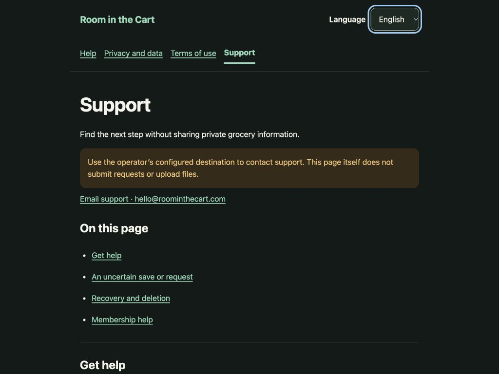
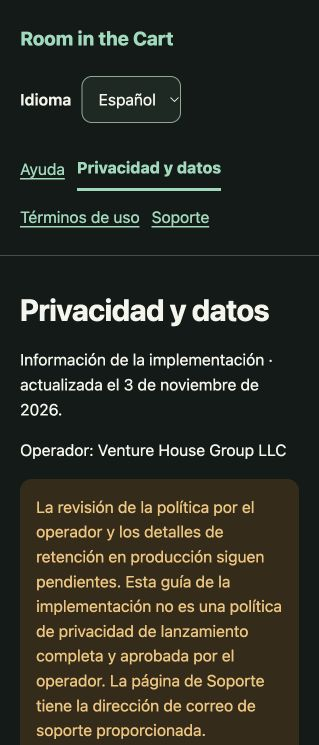

# Staging public browser walkthrough · November 6, 2026

The owner re-enabled browser access and resumed the previously deferred walkthrough. The existing staging deployment renders Help, Privacy, Terms and Support in US English and Spanish at a narrow 319 CSS-pixel viewport. Two additional views were inspected at 1024 pixels. The captured documents had no measured horizontal overflow. Public navigation preserves the chosen language, the Spanish keyboard skip link focuses `main`, and a Support section link brings its heading into view. The contact link targets `hello@roominthecart.com`; no email was sent.

The invited app's English and Spanish sign-in screens clearly show that email access is unavailable. Refresh preserves that state. Authenticated household journeys could not be exercised while email setup remains deferred. The queried browser console history contained no warning or error. A stale automation reference after resizing was resolved by reading fresh state; it did not demonstrate a product defect.

These are rendered browser observations on the existing deployed runtime, not acceptance of every device/browser, provider, policy or release claim. Privacy and Terms still display their operator-review notices. The test does not establish mailbox delivery, legal approval, iOS Safari/Android Chrome behavior, VoiceOver or human Spanish review. The page was left in English with the viewport override reset.

[Structured scope and evidence hashes](verification.json) · [Observed page structure](observations.json) · [Observed result](completion.json)

