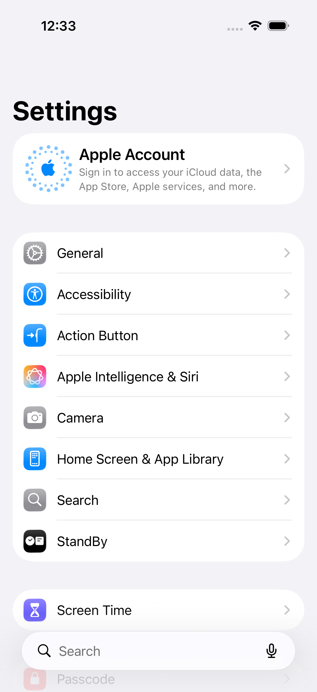

# Original f90 Settings failure inspection

The original result confirms a Settings launch timeout and explains the later navigation failure: XCTest prevented dispatch of the Accessibility tap because the test had already failed. The screenshot remains on Settings' main page with Accessibility visible. This supports no app, selector, timeout, or retry correction.

Source: [Core UI01, attempt 1](https://github.com/palatis3/room-in-the-cart/actions/runs/42428215935/job/128573980752), commit `f90ad75a2e561891b2014ecb234d19639bcaed4c`, artifact `13597417339` (`iphone-results-ui-01-1`). The 20,615,338-byte ZIP matches GitHub's SHA-256 `adb5a92cb85f6d9433f620636bfa7b8d4c4ec62cde00ec60b350aa9fe477a5fe`. All 95 entries passed the unchanged reviewed collector's path, type, uniqueness, encryption, size, count, and expansion-ratio guards. All extracted original files still match their pre-inspection hashes; the monitor's four retained result files also match. Only a disposable bundle copy was opened with xcresulttool. [Source pins](source-pins.json) · [Archive receipt](archive-receipt.json) · [Inspection proof](proof.json)

The case started at 00:32:17.672 UTC on November 8. Its detailed launch-failure activity starts at **30.087 seconds**, after Settings activation began at 0.064 seconds. The runner's platform-launch waiter completes after 30.016 seconds. A Settings PID 14068 accessibility-active notification arrives at 00:32:51.154, followed by a foreground-state update at 00:32:53.261. Automation setup begins at 36.028 seconds. These are recorded notifications, not independent measurements of when Settings first drew or became usable. [Activities](activities.json) · [Runner excerpt](runner-excerpt.json)

The Accessibility tap activity starts at 49.180 seconds. At 00:33:07.207, the runner explicitly reports `Event dispatch preempted by earlier failure.` The console's “Tap” line therefore does not establish delivered input. The subsequent eight-second Motion wait cannot demonstrate a wrong Motion query or an unresponsive delivered tap. Both retained hierarchies show the root Settings navigation bar and Accessibility row, with no Motion or Reduce Motion element. [Hierarchy excerpts](hierarchy-excerpts.json)

The original `Free-flow-failure` screenshot was attached during teardown at **58.195 seconds**. It shows Settings' main page, including the visible Accessibility row; it does not show the initial timeout boundary. The test failed at 58.420 seconds, and the retained runner reports the later XCTest issue-handling assertion and runner restart. The case never read or changed the OS preference, registered restoration, or entered the app/share journey. The entrypoint and preference-helper sections remain identical to f90; their comparison hashes are in the proof. The earlier [0d5bb1b Settings failure](../../ui10-settings-launch-20261106/proof.json) remains a separate failed invocation.

The cause of the initial launch delay remains unknown. The retained testmanagerd file contains connection/authorization bookkeeping, not an independent Settings/launch-service trace for this interval. A narrowly instrumented replay could distinguish delayed process/scene activation from delayed XCTest observation by correlating bounded Settings, SpringBoard, RunningBoard/FrontBoard, and testmanagerd events with the original runner timestamps. Preserve the original Xcode 26.3 / iOS 26.2 environment and simulator setup, both preceding ContextualNavigation cases in their recorded order, the unchanged Reduce Motion test, real OS enable/restore verification, and the existing 720/900-second case limits. Capture before the first Settings activation; do not prelaunch Settings, replace its launch API, add retries, or enlarge waits. A pass would be nonreproduction, not an explanation or correction of this original failure.

No native tests, simulator actions, workflow changes, hosted reruns, or acceptance changes occurred. Initial concurrent exports collided while xcresulttool converted the disposable copy's database; sequential exports then succeeded. That inspection-only event is retained in the proof and did not modify the original bundle. The full ZIP, original members, diagnostics, and failed-selector attachment exports remain under `.build/CIF90Nov07/settings-original/`; only the relevant screenshot, excerpts, metadata, and hashes are committed here.
