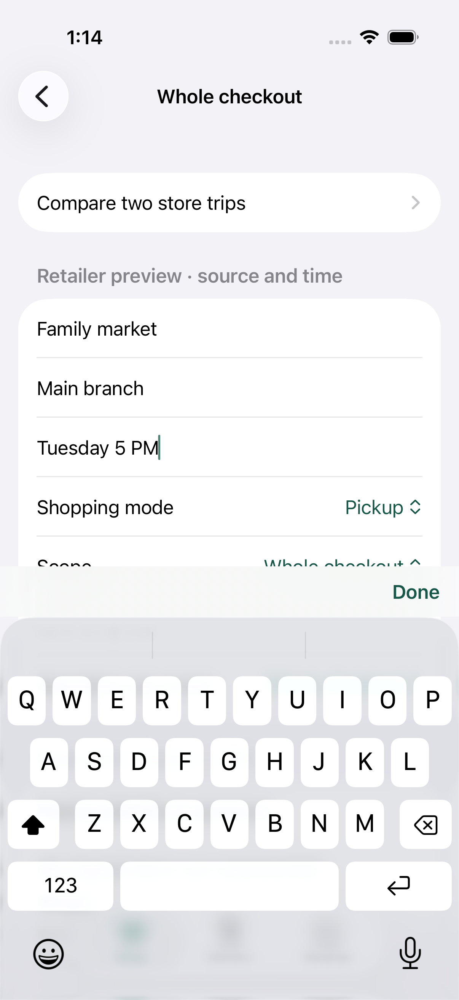

# UI04 checkout pricing review omitted by the journey

The original protected-dinner journey changed retailer terms after applying its saved pack-price choice, then searched for a source field that the pricing-review gate intentionally removes. The evidence supports following the existing replacement-pricing flow in this test. It does not support changing the app's pricing protection, scrolling limits, or keyboard driver.

[Core UI04, attempt 1](https://github.com/palatis3/room-in-the-cart/actions/runs/42428215935/job/128573980815), source `f90ad75a2e561891b2014ecb234d19639bcaed4c`, recorded five passes and this one failure at 336.636 seconds, with zero runtime warnings. Artifact `13598791272` (`iphone-results-ui-04-1`) is pinned in [metadata](artifact-metadata.json). Only guarded ranges were downloaded; the listed full-archive SHA-256 is GitHub's reference, **not an independently verified full download**. Exact fetched member CRCs, SHA-256 hashes, attachment identities, and scope are retained in the [proof](proof.json) and [export receipts](attachment-export-receipts.json). The oversized recording was not downloaded.

The [console excerpt](console-excerpt.json) records successful Store, Branch, and slot entry, followed by 24 unsuccessful source-field searches/scrolls. Its failed query lists `Family market`, `Main branch`, and `Tuesday 5 PM` with keyboard focus, but no Source field. In the original screenshot, the slot is immediately followed by Shopping mode: Source and Observed are absent from that visible layout. The earlier [pack-save screenshot](Pack-choice-saved.png) confirms the price-bearing choice was saved for checkout review. The exported final legacy snapshot contains only the app root, so it is not treated as a full hierarchy.

The [source excerpts](source-excerpts.json) explain this state. `PickupCheckoutDraft` binds known basket pricing to its original terms; changing Store, Branch, or slot sets `termsNeedFreshPricing`. `PickupCheckoutView` then hides Source/Observed, shows preserved pricing plus the changed-terms warning, disables Save, and offers **Replace pricing after review → Start replacement pricing**. The existing model regression also covers unquoted basket prices. These source sections and the journey are unchanged from f90; the failed test omitted the required review actions.

The initial investigation prepared the pinned [pricing-review sequence patch](scratch-patch-proof.json). Root installed it after source-hash verification. A complete local run then exposed a second omitted review action: the final checkout confirmation was cancelled by the generic back helper. The follow-up now verifies proposed details, saves that review once and waits for the saved checkout result before continuing.

The **complete original journey now passes locally**, including placement, short-fill, repair, settlement, next-shop reuse and restarted history. Strict verification is1/1 with zero recorded warnings/skips/restarts; both earlier local failures are retained. [Local follow-up evidence and limits](local-followup/README.md). Application sources and all later journey assertions are unchanged. Hosted follow-up remains pending; local Xcode27.1 differs from hosted26.3.
